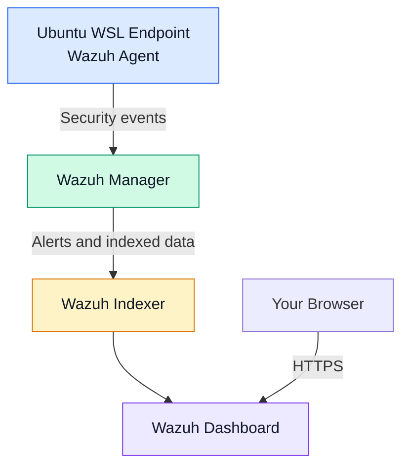

# Lab Architecture

## Environment

- Wazuh SIEM deployed using Docker Compose.
- Ubuntu endpoint running in WSL2.
- Wazuh agent configured for security event monitoring.

## Data Flow

Ubuntu endpoint → Wazuh agent → Wazuh manager → Alert investigation

## Current Status

The Wazuh environment is deployed locally. The Ubuntu agent is currently disconnected, so further end-to-end testing is pending.

## Architecture Diagram

